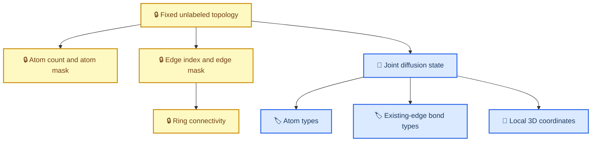

# Stage3 代码流程详细解析：固定拓扑条件下的联合化学与三维扩散

_基于当前 GPCR-RingSystem 仓库实现整理，更新于 2026-08-16。_

---

## 📋 一、编写依据与整体目标

本文参考“01—05 代码流程详细解析”的组织思路，逐阶段说明当前 Stage3 实际读取什么、怎样处理、使用哪些数学规则、输出什么，以及各模块如何衔接。本文以仓库现有代码、配置和测试为准，不把预留文件或未来计划描述为已经完成的功能。

当前 Stage3 解决的问题是：给定一个固定的二维 scaffold 拓扑、Stage2/Descriptor 条件以及 GPCR pocket，在不改变节点数和边集合的前提下，联合生成：

1. 每个固定节点上的原子类型；
2. 每条固定边上的化学键类型；
3. 每个原子的三维局部坐标。

其核心形式可以写为：

```text
固定条件：G_topology = (V, E)、pocket、descriptor
生成变量：A_t、B_t、X_t

A_t：节点原子类型
B_t：固定边上的键类型
X_t：三维坐标
```

当前完整数据流如下。

```mermaid
flowchart LR
    accTitle: Stage3 complete inference flow
    accDescr: Fixed scaffold topology, descriptor, and pocket data pass through preprocessing, field construction, joint initialization, reverse diffusion, and coordinate recovery.

    input_data([📥 Pocket + scaffold + descriptor]) --> pocket_process[⚙️ Center pocket]
    pocket_process --> build_field[⚙️ Build geometry field]
    input_data --> adapt_input[🔧 Build Stage3Input]
    build_field --> adapt_input
    adapt_input --> initialize_state[🔄 Initialize chemical and coordinate noise]
    initialize_state --> reverse_diffusion[🧠 Field-conditioned reverse diffusion]
    reverse_diffusion --> local_output[📤 Local generated state]
    local_output --> restore_global[🔄 Restore global coordinates]
    restore_global --> structured_output([📦 Structured JSON output])

    classDef input_style fill:#f3f4f6,stroke:#6b7280,stroke-width:2px,color:#1f2937
    classDef process_style fill:#dbeafe,stroke:#2563eb,stroke-width:2px,color:#1e3a5f
    classDef model_style fill:#ede9fe,stroke:#7c3aed,stroke-width:2px,color:#3b0764
    classDef output_style fill:#dcfce7,stroke:#16a34a,stroke-width:2px,color:#14532d

    class input_data input_style
    class pocket_process,build_field,adapt_input,initialize_state,restore_global process_style
    class reverse_diffusion model_style
    class local_output,structured_output output_style
```



从工程分层看，Pipeline 只负责调用现有模块，不复制 pocket 中心化、Field kernel、扩散公式或模型内部逻辑。

## 🎯 二、必须先澄清的生成边界

### 固定的是无标签拓扑

当前方案中的 topology 指无标签图结构，而不是完整化学分子。以下量在训练加噪和推理采样中始终冻结：

| 类别 | 字段 | 当前行为 |
| --- | --- | --- |
| 节点数量 | `N`、`atom_mask` | 冻结，不生成原子数量 |
| 边集合 | `edge_index`、`edge_mask` | 冻结，不生成边存在性 |
| 环连接 | 由固定边集合决定 | 冻结，不改变闭环方式 |
| 图拓扑特征 | `atom_features`、`edge_features` | 作为不变量条件传入 |
| 样本身份 | `sample_ids`、metadata | 冻结并原样传递 |

### 生成的是拓扑上的化学实现与三维构象

以下量参与扩散：

| 生成变量 | Shape | 前向过程 | 反向过程 |
| --- | --- | --- | --- |
| 原子类型 `atom_types` | `[B, N]` | 均匀类别腐蚀 | 预测干净类别并采样后验 |
| 键类型 `bond_types` | `[B, E]` | 固定边上的均匀类别腐蚀 | 预测固定边的干净键类型 |
| 坐标 `coordinates` | `[B, N, 3]` | 高斯 DDPM 加噪 | epsilon 参数化 DDPM 去噪 |

这里的 `bond_types` 只回答“已经存在的这条边是什么键”，不回答“这条边是否存在”。因此键词表只有 `SINGLE`、`DOUBLE`、`TRIPLE`、`AROMATIC`，没有 `NO_BOND` 类别。



联合化学扩散还要求每条无向化学边只存一次。模型消息传递时会在内部把这条边按两个方向使用；若输入同时保存 `i -> j` 和 `j -> i`，类别扩散会把同一化学键误当成两个独立标签，因此代码会拒绝反向重复边和自环。

## 📚 三、Stage3 基础数据契约与输入适配

### `core/types.py`：唯一共享数据结构来源

[核心类型定义](../src/gpcr_ringgen/core/types.py) 集中保存 Stage2、Descriptor、Pocket、Field 和 Stage3 之间的稳定契约，避免各模块重复定义不兼容的 dataclass。

主要结构如下：

| 数据结构 | 核心字段 | 作用 |
| --- | --- | --- |
| `MolecularGraph` | 节点、边、可选坐标与化学标签 | 表示 padded scaffold 图 |
| `DescriptorBatch` | `values [B, D]` | 保存上游 descriptor |
| `PocketBatch` | 坐标与 pocket features | 保存原始或局部 pocket 张量 |
| `BatchMask` | atom/edge/descriptor/pocket mask | 统一 padded batch 语义 |
| `BatchMetadata` | sample IDs 与自由 metadata | 保持批次身份和追踪信息 |
| `Stage2Output` | scaffold、mask、metadata | Stage2 或 mock Stage2 输出 |
| `Stage3Input` | scaffold、descriptor、pocket、field | Stage3 的完整输入边界 |
| `Stage3DiffusionState` | 图、坐标、标签、timestep、条件 | 扩散训练和采样状态 |

核心 tensor 约定：

| 字段 | Shape | dtype | Mask 语义 |
| --- | --- | --- | --- |
| `atom_features` | `[B, N, F_atom]` | floating | `atom_mask=False` 为 padding |
| `edge_index` | `[B, 2, E]` | `torch.long` | `edge_mask=False` 的位置忽略 |
| `edge_features` | `[B, E, F_edge]` | floating | 只在有效固定边上使用 |
| `atom_types` | `[B, N]` | `torch.long` | padding 必须为类别 `0` |
| `bond_types` | `[B, E]` | `torch.long` | padding 必须为类别 `0` |
| `coordinates` | `[B, N, 3]` | floating | padded 坐标在扩散中置零 |
| `descriptor` | `[B, D]` | floating | `descriptor_mask=True` 表示有效 |
| `timestep` | `[B]` | `torch.long` | 每个样本一个离散时间步 |

`validate()` 会检查 rank、shape、dtype、device、有限值、batch 对齐、边端点合法性和 mask 语义。有效边不能引用 padding 原子；原子与键类别必须同时存在或同时缺失。

### `data/transforms.py`：Stage2/mock 到 Stage3Input

[Stage2 输入适配器](../src/gpcr_ringgen/data/transforms.py) 的公开入口是：

```python
stage3_input = stage2_output_to_stage3_input(
    stage2_output,
    descriptor=descriptor,
    pocket=processed_pocket.pocket,
    descriptor_mask=descriptor_mask,
    pocket_mask=processed_pocket.pocket_mask,
    pocket_field=pocket_field,
)
```

该函数可以接收正式 `Stage2Output`，也可以接收不依赖真实 Stage2 模型的 mapping mock。它只完成类型组织与验证，不计算 descriptor、不解析 PDB、不中心化 pocket、不构造 Field，也不执行扩散。

### `data/stage3_inference.py`：标准 JSON 输入边界

[独立推理输入加载器](../src/gpcr_ringgen/data/stage3_inference.py) 把单样本 JSON 转为带 batch 轴的现有数据结构。当前标准输入包括：

- `sample_id` 与 metadata；
- 全局 pocket 坐标、features、mask 和原子/残基注释；
- 固定 scaffold 的 `atom_features`、`edge_index`、`edge_features` 与 masks；
- descriptor values 与 mask；
- 可选的干净 `atom_types` 和 `bond_types`。

推理时，拓扑 scaffold 可以不提供干净化学标签，因为联合 sampler 会从均匀类别先验初始化标签；训练数据则必须提供原子与键的干净类别作为监督目标。

## ⚙️ 四、Pocket 几何预处理与 Field Construction

### `pocket/preprocessing.py`：可逆局部坐标

[Pocket 几何预处理](../src/gpcr_ringgen/pocket/preprocessing.py) 不重复实现 PDB parser。当前仓库没有配置 RDKit、BioPython、MDAnalysis 或 ProDy 的蛋白读取依赖，因此 `read_pocket_file()` 明确保留为未实现边界；上游 parser 的输出通过 `adapt_pocket_atoms()` 进入系统。

对第 `b` 个 pocket 的有效原子，中心定义为：

```text
c_b = sum_i mask[b,i] * r[b,i] / sum_i mask[b,i]
r_local[b,i] = r_global[b,i] - c_b
r_global[b,i] = r_local[b,i] + c_b
```

`PocketCoordinateTransform.center [B, 3]` 保存平移元数据。`transform_coordinates()` 执行 global -> local，`inverse_transform_coordinates()` 执行 local -> global。这里没有 PCA 对齐和固定旋转轴，因此不会人为引入方向约束。

`ProcessedPocketBatch` 最终保存：

- 局部 `PocketBatch`；
- `pocket_mask [B, P]`；
- atom type、element、residue name/ID、可选 chain ID；
- `center [B, 3]`；
- bounding box min/max `[B, 3]`；
- bounding radius `[B]`；
- sample ID 与 metadata。

### `pocket/fields.py`：连续基础几何场

[Field 实现与查询协议](../src/gpcr_ringgen/pocket/fields.py) 将稳定 API 与具体 Gaussian 实现分开。Stage3 模型依赖 `QueryablePocketField`，不直接访问 `GaussianGeometryField` 的内部计算。

当前提供两个 channel。对查询点 `x` 和有效 pocket 原子 `r_i`：

```text
d_i(x) = ||x - r_i||_2

occupancy(x) = sum_i 1[d_i <= cutoff]
               * exp(-d_i^2 / (2 * max(sigma^2, epsilon)))

nearest_distance(x) = min_i d_i
```

`cutoff` 只截断 occupancy，nearest distance 始终返回实际最近距离。实现使用向量化 PyTorch 广播计算，不对 ligand-query/pocket-atom 进行 Python 双重循环，也不构造 voxel grid。

公开查询接口为：

```python
result = pocket_field.query(query_points, query_mask=None)
```

| 输入/输出 | 单样本 Shape | Batch Shape |
| --- | --- | --- |
| query coordinates | `[Q, 3]` | `[B, Q, 3]` |
| query mask | `[Q]` | `[B, Q]` |
| field values | `[Q, C_field]` | `[B, Q, C_field]` |

当前默认 channel 顺序固定为 `occupancy`、`nearest_distance`。`FieldQueryResult.channels` 和 `channel_metadata` 显式记录名称、顺序、含义与单位；下游可用 `select_channel(name)` 查询，避免靠数字索引猜测。

## 🔄 五、三维初始化与固定拓扑联合前向扩散

### `models/diffusion/state.py`：坐标初始化

[三维状态初始化](../src/gpcr_ringgen/models/diffusion/state.py) 使用各向同性标准高斯：

```text
Z[b,n,:] ~ N(0, I_3)
X_init = Z - valid_atom_mean(Z)
```

每个样本只使用 `atom_mask=True` 的原子计算质心，padding 坐标严格为零。`initialize_stage3_state()` 复制图、descriptor、mask、metadata 和可选化学标签，不改变二维拓扑。

### `models/diffusion/transitions.py`：坐标 DDPM

[坐标扩散过程](../src/gpcr_ringgen/models/diffusion/transitions.py) 采用 epsilon prediction：

```text
x_t = sqrt(alpha_bar_t) * x_0
      + sqrt(1 - alpha_bar_t) * epsilon

epsilon ~ N(0, I)
```

`x_0` 与 epsilon 都会投影到有效原子的零质心子空间，防止模型学习任意整体平移。`sample_timesteps()` 在 `0 ... T-1` 上均匀采样；`t=0` 是最弱的已配置噪声步，不是额外的完全干净 sentinel。

### `models/diffusion/chemical.py`：类别扩散

[联合化学扩散](../src/gpcr_ringgen/models/diffusion/chemical.py) 在固定节点和固定边上使用均匀类别腐蚀：

```text
q(z_t | z_0)
  = alpha_bar_t * one_hot(z_0)
    + (1 - alpha_bar_t) / K
```

因此时间步较小时更可能保留干净类别，时间步增大后逐渐接近 `K` 类均匀先验。`q_sample_joint()` 一次返回：

- noisy coordinates；
- noisy atom types；
- noisy existing-edge bond types；
- coordinate epsilon target；
- clean atom-type target；
- clean bond-type target。

`initialize_joint_stage3_state()` 在 `T-1` 初始化零质心 Gaussian 坐标，并对有效节点和有效固定边均匀采样类别。节点/边 mask 始终不变。

## 🧠 六、Field-conditioned 等变去噪网络与 Loss

### `models/equivariant/backbone.py`：基础 EGNN-style backbone

[等变去噪主干](../src/gpcr_ringgen/models/equivariant/backbone.py) 接收 `Stage3DiffusionState`，输出：

| 输出 | Shape | 含义 |
| --- | --- | --- |
| `coordinate_noise` | `[B, N, 3]` | 坐标 epsilon 预测 |
| `atom_type_logits` | `[B, N, C_atom]` | 干净原子类别 logits |
| `bond_type_logits` | `[B, E, C_bond]` | 固定边上的干净键类别 logits |

节点初始隐藏状态由 topology-only atom features、noisy atom-type embedding、timestep embedding、可选 descriptor 条件和可选 Field 条件相加得到。边特征由 topology-only edge features 与 noisy bond-type embedding相加得到。

EGNN message 只使用标量特征、边特征和平方距离：

```text
m_ij = phi_e(h_i, h_j, e_ij, ||x_j - x_i||^2)
delta_x_i = sum_j unit(x_j - x_i) * phi_x(m_ij)
```

绝对坐标不会作为普通标量传入 MLP。距离和网络系数是旋转/平移不变量，坐标更新沿相对位移方向，因此联合旋转会旋转向量输出，联合平移不会改变相对预测。最终还会移除预测噪声的有效原子质心。

键类别 head 使用无序端点组合 `h_i + h_j`、`|h_i - h_j|`、edge features 和平方距离，因此不会因一条无向边的端点书写顺序而改变结果。

> ⚠️ **数据要求：** `atom_features` 和 `edge_features` 必须是 topology-only 不变量。若把干净元素或干净键级编码进这些特征，会把预测目标泄漏给模型。

### `models/equivariant/field_conditioning.py`：Field 条件注入

[Field 条件封装器](../src/gpcr_ringgen/models/equivariant/field_conditioning.py) 支持两种模式：

- `none`：完全绕过 Field Query，退化为基础 denoiser；
- `additive`：在当前 `X_t` 查询 `F(X_t)`，编码为 node hidden condition 后相加。

```text
X_t + atom_mask
  -> QueryablePocketField.query
  -> field_features [B, N, C_field]
  -> scalar encoder [B, N, hidden_dim]
  -> EGNN node state
```

当前 Field channel 只依赖 pocket-query 相对距离，属于旋转和平移不变标量；descriptor 也是 batch 对齐的全局标量条件。模块只按 `descriptor_mask` 屏蔽缺失值，不在模型内部重复归一化 descriptor。

### `training/losses.py`：联合训练目标

[Loss 实现](../src/gpcr_ringgen/training/losses.py) 将三项监督组合为：

```text
L_total = lambda_x * MSE_masked(epsilon_pred, epsilon)
        + lambda_atom * CE_masked(atom_logits, atom_types_0)
        + lambda_bond * CE_masked(bond_logits, bond_types_0)
```

坐标 `mean` reduction 的分母为 `3 * valid_atom_count`。原子和键的交叉熵只对各自 mask 为 `True` 的位置计算；padding 不进入损失值和分母。

## 📦 七、Reverse Diffusion 与 Stage3 sampling

### `sampling/reverse_diffusion.py`：坐标反向步

[反向扩散与采样器](../src/gpcr_ringgen/sampling/reverse_diffusion.py) 的坐标 DDPM posterior mean 为：

```text
mu_t = 1 / sqrt(alpha_t)
       * (x_t - beta_t / sqrt(1 - alpha_bar_t) * epsilon_theta)

beta_tilde_t = beta_t * (1 - alpha_bar_{t-1})
               / (1 - alpha_bar_t)
```

当 `t > 0` 时采样 `x_{t-1} = mu_t + sqrt(beta_tilde_t) * z`；当 `t = 0` 时直接返回确定性的 `mu_0`。坐标、模型 epsilon 与 posterior noise 都保持在零质心子空间，padded atom 不会更新。

### 类别反向步

模型的 atom/bond logits 参数化 `p_theta(z_0 | z_t)`。`categorical_reverse_step()` 将预测的干净类别分布与已知均匀前向 transition 组合，得到 `p_theta(z_{t-1} | z_t)`；`t=0` 时直接从模型的干净类别分布采样。

### 两种 sampler

| Sampler | 模式 | 生成内容 |
| --- | --- | --- |
| `DDPMStage3Sampler` | `coordinate_only` | 只生成固定 scaffold 的坐标 |
| `JointDDPMStage3Sampler` | `joint_chemical` | 生成原子类型、固定边键类型和坐标 |

联合 sampler 从 `T-1` 到 `0` 执行完整 reverse chain，并在每一步同时更新三种生成变量。模型临时切换为 `eval()`，循环运行于 `torch.no_grad()`，完成后恢复原来的 train/eval 状态。

`return_trajectory=False` 是默认值。开启后只保留坐标轨迹，内容为初始化加每个反向步，共 `T+1` 个 `[B, N, 3]` tensor；默认关闭以避免 `O(T * B * N)` 内存占用。

`Stage3SamplingOutput` 保存 final state、带生成标签与坐标的 graph、metadata、可选 trajectory，并明确坐标系为 `local`。`restore_global_coordinates()` 通过 pocket transform 执行：

```text
X_global = X_local + pocket_center
```

padding 在恢复后仍保持零，不会被无意义地平移。

### Seed 策略

当前实现使用局部 device-specific `torch.Generator`，不依赖修改全局 PyTorch RNG：

| 用途 | Seed |
| --- | ---: |
| 初始 Gaussian 坐标 | `seed` |
| 初始均匀原子/键类别 | `seed + 1` |
| 联合 reverse posterior sampling | `seed + 2` |

固定输入、配置、权重、设备和软件版本时，相同 seed 可复现实验路径。

## 🚀 八、Stage3 独立推理 Pipeline

### `pipeline/stage3_inference.py`：只做 orchestration

[独立推理 Pipeline](../src/gpcr_ringgen/pipeline/stage3_inference.py) 不连接真实 Stage1/Stage2 模型，当前执行顺序为：

1. 从 YAML 读取输入路径、模型、Field、diffusion、sampling 和输出配置；
2. 从标准 JSON 加载单样本 pocket、固定/mock scaffold 和 descriptor；
3. 调用 `preprocess_pocket()` 获得局部 pocket 与 transform；
4. 调用 `build_geometry_field()` 构造可查询 Field；
5. 调用 `stage2_output_to_stage3_input()` 建立统一输入；
6. 构造 backbone 与 Field-conditioned wrapper；
7. 校验 model、diffusion 和 chemical vocabulary 的类别数量一致；
8. 加载 checkpoint，或在显式允许时使用随机权重 smoke 模式；
9. 按 diffusion mode 选择 coordinate-only 或 joint sampler；
10. 恢复 global coordinates 并写结构化 JSON。

标准命令为：

```powershell
conda activate GPCR
python scripts/run_stage3_inference.py --config configs/pipeline/stage3_smoke.yaml
```

当前 smoke 配置使用 CPU、`float32`、seed `42`、4 个 diffusion steps、additive Field conditioning，以及 9 类原子和 4 类现有边键类型。

### Pipeline 输出

结构化 JSON 至少包含：

- sample ID；
- local/global coordinates；
- 固定 `edge_index`、atom/edge mask；
- 生成的 atom/bond category IDs 与词表名称；
- descriptor 与 metadata；
- pocket center 和几何范围；
- Field channel order；
- seed、device、dtype、diffusion mode；
- checkpoint 状态；
- config reference 与完整 config snapshot；
- 可选 local coordinate trajectory。

当 `checkpoint_path: null` 时，必须显式设置 `allow_random_weights: true`。这种输出只标记为 `pipeline_smoke_test_only`，用于验证结构链路，不能解释为有化学合理性、GPCR 活性或药理有效性。

## 🧪 九、配置、测试与当前验证结果

### 主要配置文件

| 文件 | 当前职责 |
| --- | --- |
| [`configs/diffusion/ddpm.yaml`](../configs/diffusion/ddpm.yaml) | schedule、prediction type、联合模式、类别数与 loss 权重 |
| [`configs/model/equivariant_denoiser.yaml`](../configs/model/equivariant_denoiser.yaml) | EGNN 输入维度、隐藏维度、层数与类别 head |
| [`configs/model/field_conditioning.yaml`](../configs/model/field_conditioning.yaml) | `none/additive` 与 channel ordering |
| [`configs/pocket/geometry_field.yaml`](../configs/pocket/geometry_field.yaml) | sigma、cutoff、epsilon 与 channel switches |
| [`configs/pipeline/stage3_smoke.yaml`](../configs/pipeline/stage3_smoke.yaml) | 独立推理的统一运行配置 |

默认 diffusion 配置为：

```yaml
diffusion:
  mode: joint_chemical
  num_timesteps: 1000
  beta_schedule: linear
  beta_start: 0.0001
  beta_end: 0.02
  prediction_type: epsilon
  loss_reduction: mean
  num_atom_types: 9
  num_bond_types: 4
```

`chemical_vocabulary` 的当前顺序为：

```text
atom: C, N, O, S, P, F, Cl, Br, I
bond: SINGLE, DOUBLE, TRIPLE, AROMATIC
```

### 测试覆盖

当前测试覆盖：

- Stage3Input 构建、shape、dtype、mask、batch 与非法输入；
- pocket 中心化、平移一致性、global/local 可逆和几何范围；
- Field 单点、多点、batch、mask、cutoff、translation consistency；
- 初始化 seed、零质心、variable-size batch 和 topology 不变；
- denoiser forward/backward、有限梯度、旋转等变和平移一致；
- coordinate 与 categorical forward diffusion、loss 和 padding；
- Field `none/additive`、descriptor 对齐及联合刚体变换测试；
- coordinate-only 与 joint reverse sampling、seed、trajectory 和恢复全局坐标；
- 不依赖真实 Stage1/Stage2 的独立 Pipeline 集成测试。

2026-08-16 使用现有 Conda `GPCR`、Python 3.10、CPU PyTorch 环境执行完整测试：

```text
103 passed, 1 skipped in 1.44s
```

跳过项是可选 CUDA consistency test；CPU 测试全部通过。环境检查已确认 Python 3.10、Conda、包导入、配置加载、PyTorch `2.13.0+cpu` 和 CPU device 初始化成功；最后的输出探针因当前 `outputs/` 写权限被拒绝而失败，不是 Stage3 计算或测试失败。

## 📍 十、核心文件一句话说明、当前边界与结论

### 核心代码文件一句话说明

- [`core/types.py`](../src/gpcr_ringgen/core/types.py)：定义 Stage2、Descriptor、Pocket、Field 与 Stage3 的统一 tensor 契约和验证逻辑。
- [`data/transforms.py`](../src/gpcr_ringgen/data/transforms.py)：把正式或 mock Stage2 输出适配为 `Stage3Input`。
- [`data/stage3_inference.py`](../src/gpcr_ringgen/data/stage3_inference.py)：读取独立 Stage3 单样本标准 JSON。
- [`pocket/representation.py`](../src/gpcr_ringgen/pocket/representation.py)：保存 pocket 注释、坐标 transform 和几何范围。
- [`pocket/preprocessing.py`](../src/gpcr_ringgen/pocket/preprocessing.py)：完成 pocket 中心化、可逆坐标变换与几何统计。
- [`pocket/fields.py`](../src/gpcr_ringgen/pocket/fields.py)：提供稳定 Field Query API、Gaussian occupancy 与 nearest distance。
- [`models/diffusion/state.py`](../src/gpcr_ringgen/models/diffusion/state.py)：生成零质心 Gaussian 三维初始状态。
- [`models/diffusion/schedules.py`](../src/gpcr_ringgen/models/diffusion/schedules.py)：验证并预计算 linear DDPM schedule。
- [`models/diffusion/transitions.py`](../src/gpcr_ringgen/models/diffusion/transitions.py)：实现坐标前向加噪、timestep 采样和 epsilon target。
- [`models/diffusion/chemical.py`](../src/gpcr_ringgen/models/diffusion/chemical.py)：实现固定拓扑上的原子/键类别扩散和类别反向后验。
- [`models/diffusion/vocabulary.py`](../src/gpcr_ringgen/models/diffusion/vocabulary.py)：固定原子与键类别 ID 到名称的顺序。
- [`models/equivariant/layers.py`](../src/gpcr_ringgen/models/equivariant/layers.py)：实现双向消息传递和相对位移坐标更新。
- [`models/equivariant/backbone.py`](../src/gpcr_ringgen/models/equivariant/backbone.py)：预测坐标 epsilon、原子 logits 与固定边键 logits。
- [`models/equivariant/field_conditioning.py`](../src/gpcr_ringgen/models/equivariant/field_conditioning.py)：通过稳定 query API 把 Field 标量条件加到节点隐藏状态。
- [`training/losses.py`](../src/gpcr_ringgen/training/losses.py)：计算 mask-aware coordinate MSE 与 atom/bond CE 联合损失。
- [`sampling/reverse_diffusion.py`](../src/gpcr_ringgen/sampling/reverse_diffusion.py)：执行 coordinate-only 或 joint DDPM reverse chain，并恢复 global coordinates。
- [`pipeline/stage3_inference.py`](../src/gpcr_ringgen/pipeline/stage3_inference.py)：编排完整独立推理流程并生成结构化输出。
- [`scripts/run_stage3_inference.py`](../scripts/run_stage3_inference.py)：提供 YAML 驱动的命令行入口。

### 当前明确没有实现的内容

1. 不生成节点数量；
2. 不生成边存在性；
3. 不改变 ring connectivity 或 scaffold topology；
4. 不实现动态拓扑 diffusion 或 `NO_BOND` 类别；
5. 不内置完整 PDB parser；
6. 不实现 voxel、electrostatic、hydrophobic、H-bond 或 neural field；
7. 不提供已经训练好的有效 checkpoint；
8. 不宣称随机权重输出具有化学或药理意义；
9. 不连接真实 Stage1 generation 和 Stage2 screening；
10. 不实现 docking、完整评价或可靠 SDF/MOL 化学重建写出。

### 结论

当前 Stage3 已形成一条可运行、可测试、模块解耦的固定拓扑联合扩散链。它以 scaffold 的节点数、边集合和环连接方式作为不可改变的结构条件，在这些固定位置上联合扩散原子类型、现有边的键类型和三维坐标；descriptor 提供全局标量条件，GPCR pocket 经过可逆中心化后构造连续几何场，并在每个时间步通过稳定 Field Query API 条件化等变去噪网络。

因此，当前系统不是“在拓扑上生成新的图”，而是“在冻结拓扑上生成化学标签与三维实现”。下一步若继续推进，重点应是把 01—05 上游数据库稳定转换为带干净 atom/bond label、可靠 3D 坐标、descriptor 和 pocket 对齐信息的训练样本，再训练并评估当前 joint denoiser；在完成数据集、训练权重和化学评价前，独立 Pipeline 的随机权重结果仅代表工程链路已经打通。
